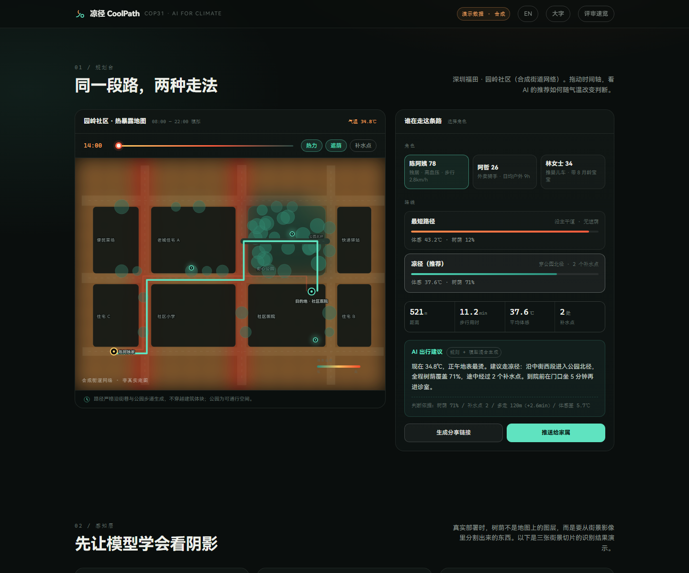

# Breeze + CoolPath · AI 高温公平决策与社区关怀路线

> **AI for Climate 青年气候黑客松 参赛作品**
> 从城市级高温公平决策，到社区级最凉步行路线——一套工具，两个尺度，同一张热模型。

## 立刻开始

| | |
|---|---|
| **▶ 作品文件（点开下载后双击即可运行）** | [climate-hackathon/breeze.html](climate-hackathon/breeze.html) |
| **🖼 截图** | [screenshots](climate-hackathon/coolpath/screenshots) |

> 作品是**单文件零依赖 HTML**，不需要服务器、不需要联网、不加载任何外部资源，浏览器双击打开就能跑。在 GitHub 上请点 **Download raw file** 下载后本地打开——GitHub 不会渲染 HTML 页面。

## 它做什么

| 模块 | 内容 |
|---|---|
| **实时天气 · 气候影响** | 6 座城市实时天气（Open-Meteo），出行 / 农业畜牧 / 动物三方面热影响计算 |
| **高温公平地图** | 24 个街区 SVG 热力图，时间轴、4 图层、风险公式、逐块检视 |
| **预算优化器** | 树木 / 喷雾 / 遮阳三种干预的成本-效益组合优化 |
| **路径规划台（CoolPath）** | 合成街道网络 + 简化地表热模型 `T = T_air + ΔT·(1 − shade)`，14:00 → 20:00 时间轴逐时重算；三角色（独居老人 / 外卖骑手 / 带娃家长）各自的最凉路线、暴晒时长、体感峰值对比 |
| **街景感知层** | 三张街景识别卡：树荫覆盖率、硬质铺装占比、饮水点可达性 |
| **社区关怀视图** | 走访优先级表：按热暴露 × 脆弱度排序，回答"先敲谁家的门" |
| **Breeze Copilot** | 基于规则 + 模板的 AI 决策建议（已披露非真实 LLM） |
| **多语言预警工作台** | 高温预警文案的多语言生成与编辑 |
| **3D 模拟世界** | 射线投射三维街区，可 WASD + 空格行走，第三人称跟随；终点医院门诊大厅有 36 m 高天柱信标导航 |
| **三语言切换** | 全站 EN / 中文 / Türkçe 一键切换，偏好写入 localStorage |

## 几个实现细节

- **三语言零位移**：中 / 英 / 土三语文案切换时图形与区块位置完全不动
- **热暴露依据**：地表温度模型参考 Landsat 8/9 TIRS 与 ECOSTRESS，遮荫降温量级参考 EPA 实测
- **三维街区**：零依赖贴图射线投射 + 真三维体块渲染，建筑立面程序化生成
- **AI 主动推翻自己**：把时间轴拖到 20:00，推荐会降级为最短路径——一个不敢否定自己的模型不值得信任

<table>
<tr>
<td></td>
<td></td>
</tr>
<tr>
<td align="center">三维街区模拟</td>
<td align="center">终点天柱信标</td>
</tr>
<tr>
<td></td>
<td></td>
</tr>
<tr>
<td align="center">住宅 C 老小区（可走进去）</td>
<td align="center">规划台：热暴露地图 + 双路线</td>
</tr>
</table>

---

## 仓库里的其他东西（历史项目）

- `app.js` / `pages/` / `components/` … —— 博雅语言教培微信小程序源码（早期项目，已闲置）
- `climate-hackathon/coolpath/coolpath.html` —— CoolPath 独立版本（已合并入主作品 breeze.html，保留作过程记录）

许可：[MIT](climate-hackathon/coolpath/LICENSE) · 作者：Eamon-2014
