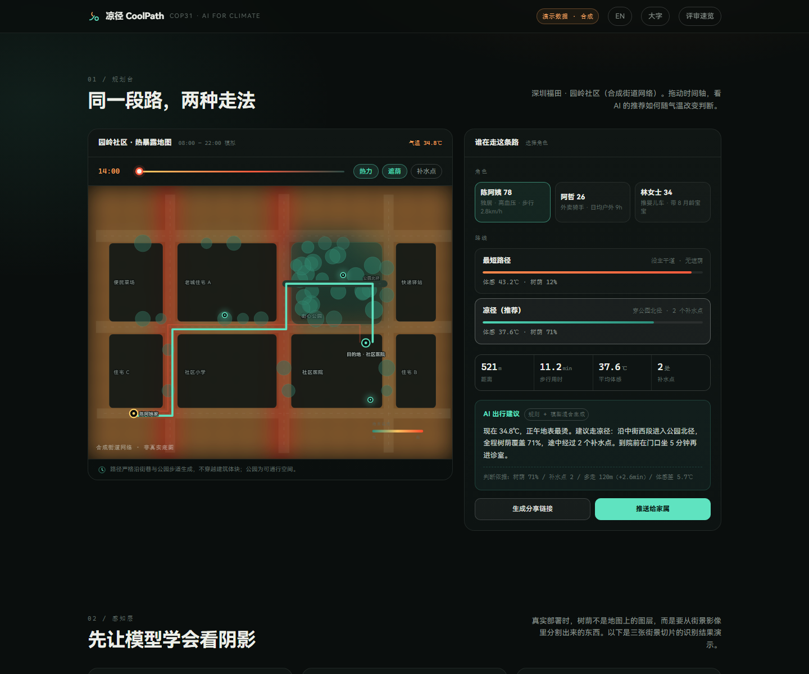
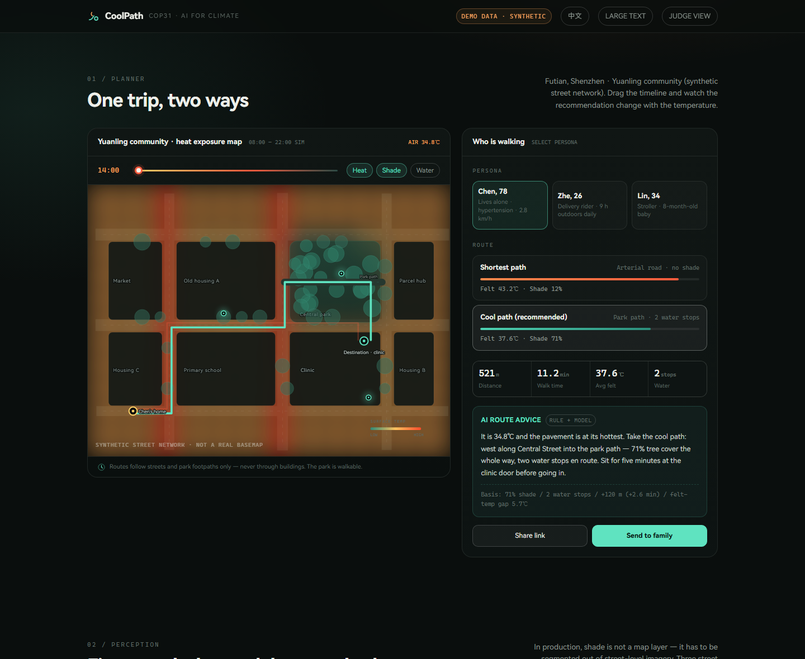

# 凉径 CoolPath

> 让城市里最热的那三百米，有一条更凉的路。

**凉径 CoolPath** 是一个面向极端高温的社区气候适应原型：用 AI 把「热风险」翻译成两个可执行的决策 —— 给脆弱人群一条**最低热暴露**的步行路线，给社区工作者一张**今天该先敲谁家门**的走访名单。

单文件 HTML，零依赖、零构建、可离线运行。


---

## 为什么做这个

极端高温是最沉默的气候灾害：它不掀翻屋顶，只是一次次把老人留在了去买菜的路上。而行军式的高温预警对个体几乎无用 —— 「今天 38℃」不能告诉你该走哪条路、几点出门、路上哪里能喝水。

真正缺的不是一张更红的热力图，而是一个能执行的动作。

## 它做什么

| 模块 | 说明 |
| --- | --- |
| **01 热暴露规划台** | 社区街道级热力场 + 时间轴（14:00–20:00）；对比「最短路径」与「凉径」的体感温度、树荫覆盖、补水点；针对独居老人 / 骑手 / 婴幼儿家庭给出不同推荐 |
| **02 街景感知** | 从街景影像中分割树冠、沥青铺装、遮阳设施，产出遮荫系数 —— 这是热模型真正的输入 |
| **03 社区关怀视图** | 同一热模型反向使用：按「热暴露 + 人口脆弱度 + 建筑散热」排序楼栋，输出带动作的走访清单 |
| **04 方法与边界** | 数据来源、AI 分工、模型失效场景、2 周 → 8 周的验证计划 |
| **双语切换** | 右上角 EN / 中文 一键切换全部文案（含动态生成的建议），支持 `?lang=en` 直链 —— 活动工作语言为英语，路演时可全程英文演示 |
| **角色联动地图** | 切换角色时地图同步高亮该角色的关注要素：老人→公园北径树荫段、骑手→无遮荫 62℃ 路段（红色警示带）、家长→三个转角的坡道/无台阶节点；支持 `?p=rider` 直链 |
| **科学依据** | 方法区新增「科学依据」栏：WBGT(ISO 7243)/UTCI 指标体系、EPA 遮荫降温实测（11–25℃）、SOLWEIG 平均辐射温度制图、累计热暴露 ∫T·dt 目标函数、巴黎清凉岛/新加坡 Cooling Singapore 先例 |
| **第三人称模拟世界** | 地图下方「进入模拟世界」：零依赖贴图射线投射引擎 + 真三维体块渲染。建筑立面程序化生成五种贴图（深色窗框、玻璃天光反射、层间梁、空调外机、阳台栏板、卷帘门、店招、楼顶水箱/机房/太阳能/天线、沿街雨棚带支撑柱）；街景道具全部三维建模——公园树林（树干+球状树冠）、三个石质饮水点、长椅、路灯、垃圾桶、花坛；**住宅 C 老小区**（2 号楼六层板楼 + 3 号楼 + 西侧老楼，外凸阳台栏板、楼梯间、单元门雨棚、楼号牌；围栏+敞开大门+车棚+晾衣架+院内树椅，大门可走进去）与**小学**（围墙+校门+操场跑道+单杠+旗杆，可走进去）；终点是三维医院门廊（雨棚/立柱/玻璃自动门/绿十字灯箱/台阶/导医牌）；**终点天柱信标**：一道 36 m 高的青白光柱冲天而起、高于全城所有建筑，隔着楼也能看见，地面光斑+上升能量环；骨骼动画角色（陈阿姨拄拐、骑手背外卖箱、林女士推婴儿车），相机滞后跟随转身可见侧面，WASD + 空格 + Shift 快走 + 拖动转向；地面导航路径线 + 逐段转向指引 + 小地图；街道暴晒 vs 树荫降温实时反映在体感读数与热浪暗角中，抵达后输出暴晒总结 |
| **按角色区分起终点** | 起点/终点标注随角色变化：陈阿姨家 / 小吃街·取餐点 / 住宅C·2号楼 → 目的地社区医院（送单点/儿科门诊） |





## AI 在这里做了什么

1. **视觉分割** —— 从街景中提取树冠 / 铺装 / 遮阳设施，转成遮荫系数（`canopy`、`asphalt`、`awning` 置信度）
2. **多目标路径优化** —— 目标函数是累计热暴露，不是最短距离；约束含补水点密度、无障碍通行、绕行成本
3. **LLM 改写** —— 把数值结果翻译成老人听得懂的一句话，而非把仪表盘丢给用户

## 一个诚实的细节

把时间轴拖到 **20:00**，AI 会主动推翻自己上午的推荐：

> 夜间体感差只剩 1.1℃，走最短路径更划算 —— 凉径多绕的 122 米此刻换不来对应的收益。

一个不敢否定自己的模型，不值得被信任。这是全篇最想让人看到的一秒。

## 运行

```bash
# 方式一：直接双击
open coolpath.html        # macOS
start coolpath.html       # Windows

# 方式二：本地起服务
python -m http.server 8000
# 打开 http://localhost:8000/coolpath.html
```

无外部请求、无 CDN、无追踪、无需登录。适合在受限网络下做现场演示。

## 交互

- **时间轴** 14:00 / 16:00 / 18:00 / 20:00 —— 改变热力场与推荐逻辑
- **角色** 陈阿姨（78 岁独居）/ 阿哲（外卖骑手）/ 林女士（推婴儿车）—— 改变速度、阈值与建议
- **图层** 热力 / 遮荫 / 补水点
- **路线卡** 切换最短路径与凉径，地图与指标同步
- **大字按钮** 无障碍字号模式（右上角）
- **评审速览** 右上角抽屉，按评分维度逐条对应
- **EN / 中文** 语言切换，偏好写入 localStorage，`?lang=en` 可直达英文版
- **双语版面零位移**：切换语言时图形与区块位置完全不动（双语言高度自动取最大锁定）

## 重要声明

页面中**全部地理与温度数据均为合成演示数据**，用于说明交互与判断逻辑，不代表任何真实测量结果。热模型未做实测标定，绝对温度不可信，只有相对比较有意义。

真实部署需要：Sentinel-2 / Landsat 地表温度、街景影像采集、社区气象站小时级实测、以及社区授权的匿名人口统计口径。

## 技术栈

原生 HTML + CSS + SVG + 普通 JavaScript。没有框架，没有构建步骤，一个文件 60KB。

热力场为 16×12 网格采样后用高斯模糊平滑渲染；路径长度由 `getTotalLength()` 实时换算，指标随角色与时段动态计算。

## 背景

为 **ATOX「AI for Climate 青年气候黑客松」** 构建的原型（2026 年 11 月 14–15 日线上，11 月 18 日 COP31 安塔利亚 GAUC 展馆决赛展示）。

## 许可

[MIT](LICENSE)
